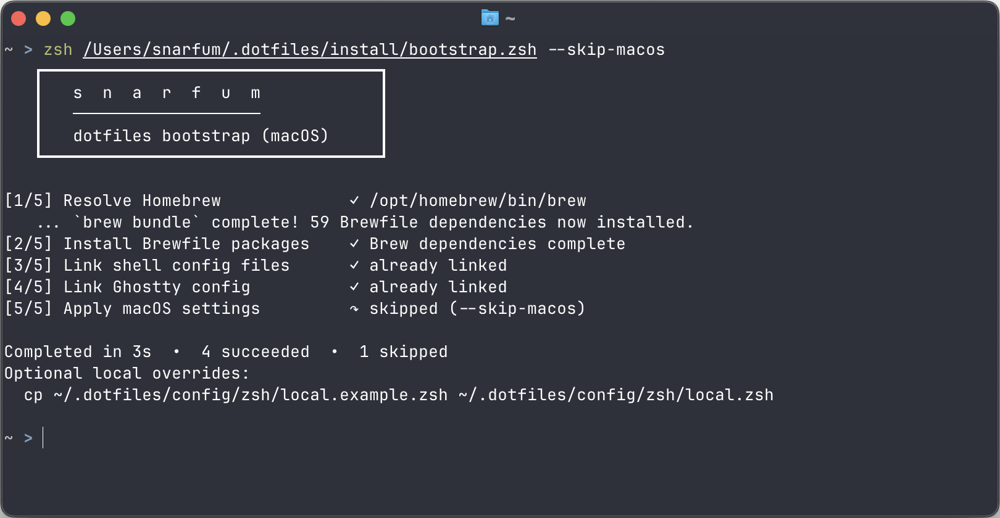

# Dotfiles



Personal dotfiles for reproducible shell and workstation setup, centered on macOS with secondary Windows and Debian server bootstrap entrypoints.

## Purpose

This repo bootstraps a machine with packages, shell config, and a small set of app
configs while preserving existing user files via timestamped backups.

## Supported Platforms

- **Primary**: macOS 14+ (Homebrew-based bootstrap via `install/bootstrap.sh`).
- **Secondary**: Windows (WSL-first) via `install/bootstrap.ps1`.
- **Secondary**: Debian server via `install/bootstrap.sh`.
- **Unsupported**: Other Linux distributions for config reuse only; no generic Linux bootstrap entrypoint.

See [Platform Notes](docs/PLATFORMS.md) for details and prerequisites.

## Quick Install

macOS

```zsh
git clone https://github.com/Smaths/.dotfiles.git ~/.dotfiles
sh ~/.dotfiles/install/bootstrap.sh
```

Windows (PowerShell): Note the Bypass command, review code before executing.

```powershell
git clone https://github.com/Smaths/.dotfiles.git $HOME/.dotfiles
powershell -ExecutionPolicy Bypass -File $HOME/.dotfiles/install/bootstrap.ps1
```

Debian server:

```bash
git clone https://github.com/Smaths/.dotfiles.git ~/.dotfiles
sh ~/.dotfiles/install/bootstrap.sh
```

> [!WARNING]
> Review and understand the bootstrap scripts before execution. The dotfiles repo will modify shell configuration files and install packages. Ensure backups exist and you have rollback understanding (see [Rollback / Uninstall](#rollback--uninstall)).

Linux:

- Debian servers are supported through `install/bootstrap.sh`, which dispatches to `install/platforms/debian/bootstrap.sh`.
- Other Linux distributions can reuse config modules manually.

### Flags

Global:

```zsh
sh install/bootstrap.sh --dry-run
sh install/bootstrap.sh --yes
sh install/bootstrap.sh --verbose
```

macOS-only:

```zsh
sh install/bootstrap.sh --upgrade-packages
```

Windows-only:

```powershell
--skip-packages
--link-windows-shell
```

Debian-only:

```bash
--skip-packages
--force-shell
```

## Safe Defaults

- Cross-platform:
  - Idempotent intent: reruns should be safe and mostly no-op when already configured.
  - Interactive terminal runs print a preflight plan and ask for confirmation
    before mutating. Non-interactive mutation requires `--yes`; use
    `--dry-run` to inspect the plan without changing anything.
  - Before relinking `~/.zshrc` or `~/.zprofile`, existing files, directories,
    and incorrect symlinks are moved to collision-safe timestamped backups
    (`.bak.YYYYmmddHHMMSS[.N]`). Correct symlinks remain unchanged.
- macOS:
  - Interactive system defaults are opt-in and run separately with
    `zsh ~/.dotfiles/install/platforms/macos/settings.zsh`.
  - Homebrew package upgrades require explicit `--upgrade-packages` opt-in.
  - macOS setup prompt modes:
    - use defaults (no per-setting prompts)
    - choose settings (set defaults, then proceed)
    - skip
- Windows:
  - Validates `winget` package IDs before installation.
  - Checks symlink capability only when `--link-windows-shell` is requested.
- Debian:
  - Uses apt packages from `install/platforms/debian/apt-packages.txt`.
  - Links `~/.bashrc` to `config/bash/.bashrc` with timestamped backup behavior.
  - Leaves the login shell unchanged unless `--force-shell` is passed.
- Shell config:
  - Prompt Purification is vendored under `config/zsh/prompts/purification/`
    and loads from the repository, so Zsh uses the same prompt without a
    separate per-machine download.
  - Node.js 24 LTS and pnpm 11 are the defaults; the macOS bootstrap installs
    them from `config/mise/config.toml` after Brew Bundle completes.
  - Pi is installed from the same mise config as the `pi` terminal agent,
    independently of project Node.js versions.
  - Homebrew installs `uv`; the tracked uv config requires uv-managed Python
    interpreters. Apple/Xcode Python remains untouched and is not used as a
    global package environment. Standalone applications such as the official
    OpenAI CLI remain Homebrew-owned rather than Python packages.
  - `mise` reads existing `.nvmrc` and `.node-version` files for per-project
    Node.js switching and project `packageManager` fields for pnpm switching.
    npm remains available from each managed Node.js install.
  - Runtimes resolve through mise shims on `PATH` (`config/zsh/path.zsh`) rather
    than `mise activate`, so scripts, editors, git hooks, and other non-zsh
    processes get the same versions the terminal does.
  - `fzf` defaults are wired to `fd` (`FZF_DEFAULT_COMMAND`, `FZF_CTRL_T_COMMAND`)
    with hidden files included and shared excludes for heavy paths (for example:
    `.git`, `node_modules`, `.cache`, `dist`, `build`, `.next`, `.turbo`,
    `coverage`, `target`). `config/zsh/plugins.zsh` also loads fzf's key
    bindings, so `ctrl-r`, `ctrl-t`, and `alt-c` are available in the shell.
  - Zsh plugins are git clones under
    `${XDG_DATA_HOME:-~/.local/share}/zsh/plugins` rather than Homebrew
    formulae, so one set of load paths works on macOS and Linux.
  - `zoxide` adds `z` and `zi` frecency jumps; `cd`, `AUTO_CD`, and the
    directory stack are deliberately left alone.
  - `eza` backs the `ls` family when installed, adding a git status column.
    `command ls` still reaches coreutils, and machines without `eza` keep the
    original coreutils aliases.
  - `delta` renders git diffs through a tracked include, and `lazygit` is
    configured to page through the same renderer.
  - 1Password SSH agent routing is configured in `config/zsh/env.zsh` via `SSH_AUTH_SOCK` when the socket exists; keep app-injected shell snippets in `config/zsh/local.zsh` instead of tracked entrypoints.
  - Alias modules load from `config/zsh/aliases/*.zsh` in lexical order; keep project/machine-specific overrides in `config/zsh/local.zsh`.

## Features

### Vendored Zsh Prompt

- Prompt Purification is vendored at
  `config/zsh/prompts/purification/prompt_purification_setup` and loaded by
  `config/zsh/options.zsh`.
- `config/zsh/prompts/purification/UPSTREAM.md` records the reviewed upstream
  commit, content hashes, author, license, and update procedure.
- No prompt-specific download or package installation runs during bootstrap;
  linking `~/.zshrc` makes the repository-owned prompt active.
- The prompt applies to Zsh configurations only. Debian's managed Bash config
  remains independent.

### Managed mise Tools

- `mise` owns the Node.js and pnpm versions instead of Homebrew `node`, nvm, or
  a global Yarn install.
- The tracked global config keeps Node.js 24 LTS and pnpm 11 as defaults.
  Project `.nvmrc`, `.node-version`, and `packageManager` files remain the
  source of truth for selecting other versions through mise.
- Bootstrap symlinks `config/mise/config.toml` to
  `${XDG_CONFIG_HOME:-~/.config}/mise/config.toml`, the path mise reads by
  default. No environment variable is required, so the toolchain is identical in
  the terminal and in any process that never sources `~/.zshrc`.
- Follow each project's lockfile and `packageManager` field instead of adding
  project-specific pnpm releases to the global tool list.
- Vite and other build tools remain project dependencies; for example, start a
  Vite project with `pnpm create vite`.

### Managed Python Tools

- Homebrew owns the `uv` executable and standalone native CLIs; `uv` owns
  Python interpreters, project environments, and Python-package tools.
- `config/uv/uv.toml` sets `python-preference = "only-managed"`, preventing uv
  from installing into or depending on Apple/Xcode or Homebrew Python.
- Project libraries belong in each project's `pyproject.toml` and `uv.lock`,
  not in a shared user-level Python environment. Use `uv run` inside projects
  and `uvx` for temporary Python tools. Use `uv tool install` only for a
  persistent CLI that is actually distributed as a Python package and has no
  preferred native package.

### Fuzzy Navigation Helpers

- `fcd [root]`: fuzzy-select a directory and change into it.
- `ffcd [root]`: fuzzy-select a file and change into that file's directory.
- `fview [root]`: fuzzy-select a file and view it in-terminal (`bat`/`less`).
- `fstack`: fuzzy-select a `dirs -v` stack entry and jump to it.
- fzf key bindings: `ctrl-r` history search, `ctrl-t` file picker, `alt-c` cd.
- `z <partial>` / `zi`: zoxide frecency jumps.

### Managed Zsh Plugins

- The plugin set lives in `install/lib/zsh-plugins.sh` and is cloned to
  `${XDG_DATA_HOME:-~/.local/share}/zsh/plugins`:
  - [fzf-tab](https://github.com/Aloxaf/fzf-tab): replaces the Tab completion
    menu with an fzf picker and file/directory previews.
  - [zsh-autosuggestions](https://github.com/zsh-users/zsh-autosuggestions):
    inline suggestions from history.
  - [fast-syntax-highlighting](https://github.com/zdharma-continuum/fast-syntax-highlighting):
    command-line syntax highlighting.
- Load order in `config/zsh/plugins.zsh` is load-bearing: fzf-tab loads after
  `compinit` and before anything that wraps ZLE widgets, and
  fast-syntax-highlighting loads last so it sees every widget the earlier
  plugins created.
- Every plugin is optional at runtime. A missing clone is skipped rather than
  erroring, and completion falls back to zsh's built-in menu, so a machine that
  has not been bootstrapped still gets a working shell.
- Bootstrap clones missing plugins on every run and only fast-forwards existing
  clones when `--upgrade-packages` is passed, matching the Brewfile policy. A
  directory that is not a git clone is reported and left untouched.

### Delta Diff Rendering

- `config/git/delta.gitconfig` is tracked and linked to
  `${XDG_CONFIG_HOME:-~/.config}/git/delta.gitconfig`.
- `~/.gitconfig` stays user-owned: bootstrap adds a single `include.path` entry
  pointing at the linked file and changes nothing else in it. Removing that one
  line restores git's built-in pager.
- lazygit does not read git's `core.pager`, so `config/lazygit/config.yml`
  wires the same renderer into the TUI. lazygit rewrites that file in place when
  it migrates its own config schema; because it is linked into this repo, such a
  migration appears as a normal working-tree change to review and commit.

## What Gets Managed

- Shared:
  - Symlink targets:
    - `~/.zshrc` -> `~/.dotfiles/config/zsh/.zshrc`
    - `~/.zprofile` -> `~/.dotfiles/config/zsh/.zprofile`
  - Zsh startup chain: `config/zsh/.zprofile` loads `path.zsh`; then
    `config/zsh/.zshrc` loads the interactive modules.
  - Vendored Prompt Purification source and provenance metadata under
    `config/zsh/prompts/purification/`.
- macOS:
  - Homebrew packages and casks from `install/platforms/macos/Brewfile`
    (includes jq, shell validation tools, Herdr, mise, eza, zoxide, git-delta,
    lazygit, Hex voice-to-text on Apple Silicon, Unity Hub, VS Code, Zed,
    Sublime Text, ChatGPT, Claude, Codex, and Claude Code).
  - Bootstrap installs missing Brewfile entries without upgrading existing packages by default; pass `--upgrade-packages` to upgrade outdated entries.
  - Pinned Node.js, Pi, and pnpm versions from `config/mise/config.toml`.
  - mise config symlink:
    - `$XDG_CONFIG_HOME/mise/config.toml` -> `~/.dotfiles/config/mise/config.toml`
  - uv config symlink:
    - `$XDG_CONFIG_HOME/uv/uv.toml` -> `~/.dotfiles/config/uv/uv.toml`
  - Homebrew, Brew Bundle, and mise installation commands run in the
    foreground with their native prompts, status output, signals, and exit codes.
  - Brew Bundle streams verbose install output while running up to four formula
    jobs in parallel, so long installs continue to show activity after fetching.
  - First-time Homebrew setup downloads the official installer to a temporary
    file before running it, preserving terminal input for confirmation and
    `sudo` prompts; the temporary file is removed on success or failure.
  - Zsh plugin clones from `install/lib/zsh-plugins.sh` in
    `${XDG_DATA_HOME:-~/.local/share}/zsh/plugins`.
  - Ghostty symlink:
    - `$XDG_CONFIG_HOME/ghostty/config` -> `~/.dotfiles/config/ghostty/config`
  - tmux symlink:
    - `~/.tmux.conf` -> `~/.dotfiles/config/tmux/tmux.conf`
  - delta symlink, plus one `include.path` entry in the otherwise unmanaged
    `~/.gitconfig`:
    - `$XDG_CONFIG_HOME/git/delta.gitconfig` -> `~/.dotfiles/config/git/delta.gitconfig`
  - lazygit symlink:
    - `~/Library/Application Support/lazygit/config.yml` -> `~/.dotfiles/config/lazygit/config.yml`
  - Optional standalone interactive system defaults in `install/platforms/macos/settings.zsh`.
- Windows:
  - Packages from `install/platforms/windows/winget-packages.txt` via `winget` (when available).
  - WSL-first guidance output (installs/linking commands for WSL shell environment).
  - Windows-host zsh linking only when `--link-windows-shell` is passed.
- Debian:
  - Packages from `install/platforms/debian/apt-packages.txt` via `apt-get`.
  - Bash symlink:
    - `~/.bashrc` -> `~/.dotfiles/config/bash/.bashrc`
  - Optional login shell update to bash via `--force-shell`.

## Rollback / Uninstall

1. Remove symlinks if present.
2. Restore backups created by bootstrap (`*.bak.<timestamp>[.N]`) as needed.
3. Optionally uninstall managed packages.
4. Remove the repo clone.

> [!WARNING]
> `brew bundle cleanup` uninstalls everything Homebrew manages that the Brewfile
> does not list, including transitive dependencies. Run
> `brew bundle cleanup --file ...` without `--force` first and read the list:
> any package installed by hand and never added to the manifest is removed. Only
> use `--force` once that list contains nothing you want to keep.

macOS cleanup commands:

```zsh
rm -f ~/.zshrc ~/.zprofile
rm -f ${XDG_CONFIG_HOME:-$HOME/.config}/ghostty/config
rm -f ${XDG_CONFIG_HOME:-$HOME/.config}/git/delta.gitconfig
git config --global --unset include.path "${XDG_CONFIG_HOME:-$HOME/.config}/git/delta.gitconfig"
rm -f ~/Library/Application\ Support/lazygit/config.yml
rm -rf ${XDG_DATA_HOME:-$HOME/.local/share}/zsh/plugins
brew bundle cleanup --file ~/.dotfiles/install/platforms/macos/Brewfile --force
rm -rf ~/.dotfiles
```

Windows cleanup commands:

```powershell
Remove-Item $HOME\.zshrc,$HOME\.zprofile -Force -ErrorAction SilentlyContinue
# Then remove package installs manually or via winget uninstall as needed.
Remove-Item $HOME\.dotfiles -Recurse -Force
```

Debian cleanup:

```bash
rm -f ~/.bashrc
# Restore ~/.bashrc.bak.<timestamp>[.N] if needed.
rm -rf ~/.dotfiles
```

Other Linux cleanup:

- Remove any manual symlinks you created.
- Remove the repo clone.

## Entry Points

- Unix bootstrap wrapper: `install/bootstrap.sh`
- Windows bootstrap wrapper: `install/bootstrap.ps1`
- macOS bootstrap: `install/platforms/macos/bootstrap.zsh`
- Windows bootstrap: `install/platforms/windows/bootstrap.ps1`
- Debian bootstrap: `install/platforms/debian/bootstrap.sh`
- macOS settings (optional): `install/platforms/macos/settings.zsh`
- Shared Unix bootstrap behavior: `install/lib/common.sh`
- Homebrew installer helper: `install/lib/homebrew.sh`
- Shared Unix bootstrap UI: `install/lib/ui.sh`
- Zsh plugin manifest and installer: `install/lib/zsh-plugins.sh`
- macOS package manifest: `install/platforms/macos/Brewfile`
- Windows package manifest: `install/platforms/windows/winget-packages.txt`
- Debian package manifest: `install/platforms/debian/apt-packages.txt`
- Zsh startup chain: `config/zsh/.zprofile` -> `config/zsh/path.zsh`, then
  `config/zsh/.zshrc` -> interactive `config/zsh/*.zsh` modules
- Debian bash entrypoint: `config/bash/.bashrc`

## Validation Commands

Run after changing install/config behavior:

```zsh
bash tests/check.sh
brew bundle check --no-upgrade --file ~/.dotfiles/install/platforms/macos/Brewfile
```

`tests/check.sh` is the single source of truth for static validation and shared
bootstrap helper tests. CI runs the same script.

Debian dry-run check:

```bash
sh ~/.dotfiles/install/bootstrap.sh --dry-run --skip-packages
```

Windows package manifest check:

```powershell
Get-Content $HOME/.dotfiles/install/platforms/windows/winget-packages.txt | `
  Where-Object { $_ -and -not $_.StartsWith('#') } | `
  ForEach-Object { winget search --id $_ -e }
```

Inspect the managed runtimes:

```zsh
mise current
node --version
pnpm --version
uv python list --only-installed
openai --version
```

## Off-Limits and Invariants

- Scripts should not delete user files by default.
- No secret material (tokens/keys/passwords) should be committed.
- Network installs are limited to explicit bootstrap dependencies (`brew`,
  `mise`, `uv`, `winget`, `apt-get`, `git`, `curl`).

See:

- [Architecture](docs/ARCHITECTURE.md)
- [Platform Notes](docs/PLATFORMS.md)
- [Operations](docs/OPERATIONS.md)
- [Contributing](CONTRIBUTING.md)
- [Security](SECURITY.md)
